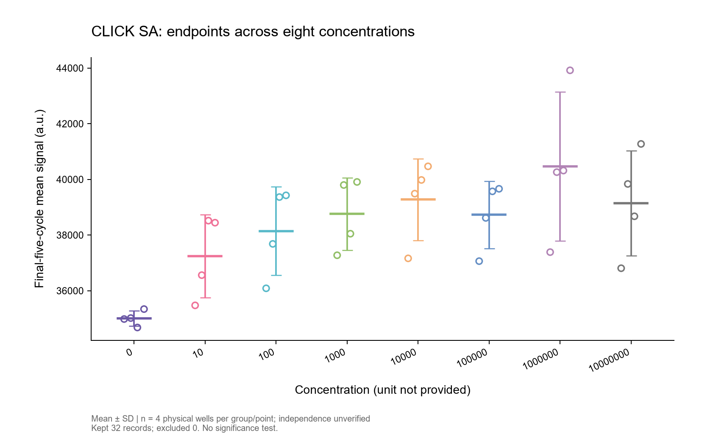
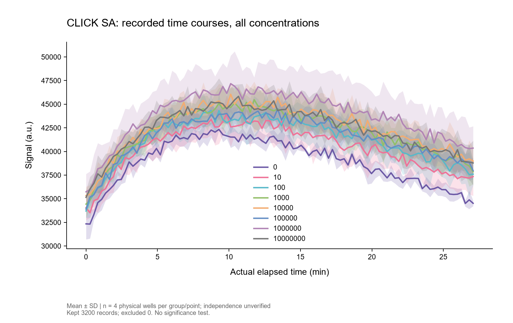
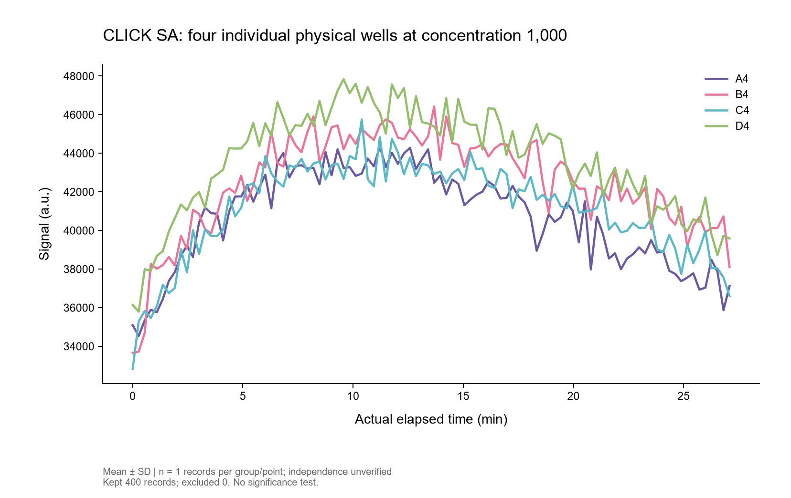

# Caelo BME · Biomedical Research Workbench

An English desktop agent for biosensing experiments, disease-detection research, local scientific analysis, and paper review. It combines the [Caelo desktop](https://github.com/AuraVixStudio/caelo) with restricted BME tools and optional OpenAI GPT assistance. General research and everyday questions are also supported.

**Version 0.1.1 · Development preview · Project period: March–November 2026**

[Real experimental results](#results-from-real-experimental-data) · [Data and method](docs/demo/REAL-DATA-METHOD.md) · [中文](#中文介绍)

## What you can do

| Workflow | Current implementation |
| --- | --- |
| Research conversation | Streaming OpenAI Responses; experimental-step reasoning, troubleshooting hypotheses, paper explanations, and general questions. Ordinary messages send directly. |
| Data analysis and plotting | CSV/TSV/XLSX, including recognized Spark kinetics; local inspection; explicit axes/group/well mapping; mean with SD/SEM; reviewed PNG and ZIP exports containing SVG, statistics, hashes, and row decisions. |
| Paper review | Read local text/PDF, inspect physical PDF pages and citations, and deliberately ask GPT to summarize selected content. |
| Image-folder monitoring | Detect stable new images locally every two seconds. Metadata notifications do not automatically upload images or trigger paid inference. |
| Local state | Recover research conversations; encrypt credentials with Electron safeStorage; select a model returned by the account; record a timestamped **manual balance snapshot**. |

The balance field is a user-entered snapshot, not a live billing API. Model listing alone does not guarantee Responses, tools, or vision support. API access requires a separately configured account/key.

## Results from real experimental data

These figures were generated by the application's local analysis engine from the owner's **real CLICK SA experiment**, not generated measurements: **3,200 recorded readings, 32 physical wells, and eight supplied concentrations (0 and 10¹–10⁷)**. All readings and the 32 final-five-cycle endpoints were reconciled against the unchanged original workbook.

### Endpoint response

Each circle represents a physical well's mean signal over its final five recorded cycles. Lines and error bars show the mean and sample SD across four physical wells per concentration.



### Full time courses

All 3,200 readings are retained. Lines and shaded bands show mean and sample SD across four physical wells at each concentration and cycle, using actual recorded elapsed time.



### Four individual wells

All 400 readings from A4–D4 at the supplied concentration of 1,000 are shown individually. A single trace does not have an inferred standard deviation.



**Zero exclusions.** No smoothing, interpolation, or removal of points to force an increasing response. Concentration units were not provided; biological independence is unconfirmed. Four physical wells do not establish four biological replicates. No live GPT request was needed to generate these local results.

Only derived result figures and the method note are published for this example. Original Excel/CSV and full record-level audit bundles stay private. See [the method](docs/demo/REAL-DATA-METHOD.md).

## Source and output boundaries

Connect a source directory using the native picker. Sources are read-only; output roots must be separate. Exports use unique names and exclusive creation. Path checks reject traversal, overlapping roots, symlinks/reparse points, and hardlinks.

The BME agent exposes fixed analysis/document/image tools. Arbitrary shell, source writes/deletes, terminal, Git mutations, third-party MCP, hooks, LSP, subagents, generated HTML execution, and upstream auto-updates are disabled. Model-generated saved figures/drafts require approval; normal chat has no repeated send-confirmation dialog.

Connecting a folder does not upload it wholesale. Chat and document/image content deliberately read into model context are sent to the configured OpenAI endpoint and retained in local conversation history. Local plotting needs no model request. These are application-level safeguards, not an OS sandbox or an absolute file-safety guarantee.

This research preview is not a clinical diagnostic system. General external-software automation and arbitrary user-code execution are not implemented.

## Technology

| Layer | Technology and role |
| --- | --- |
| Desktop | Electron 45.2.1, native directory dialogs, context isolation, safeStorage |
| Interface | React 19, TypeScript, Tailwind CSS, Caelo components/Markdown |
| Local service | Python 3.12, FastAPI, authenticated loopback REST/WebSocket |
| Model integration | OpenAI Responses streaming, fixed tool dispatch, `store:false`, account model lookup |
| Scientific engine | Matplotlib PNG/SVG, mean/sample SD/SEM, openpyxl read-only Excel |
| Documents and images | pypdf, pypdfium2, Pillow; local stable-file polling |
| Persistence | SQLite/JSON history and state, OS-encrypted credentials |
| Validation | pytest, Vitest, TypeScript, ESLint, production build, real-source reconciliation |

## Run from source on Windows

From this directory, with Python 3.12, Node.js and npm installed:

```powershell
python -m venv caelo_core/.venv
caelo_core/.venv/Scripts/python.exe -m pip install -r caelo_core/requirements.txt -r caelo_core/bme/requirements.txt
Set-Location desktop
npm ci --ignore-scripts
# Fetch the official development Electron binary explicitly:
node node_modules/electron/install.js
npm run build
node_modules/electron/dist/electron.exe .
```

In **Connection & settings**, enter your own API key, refresh account models, and select one supported by your endpoint. Connect a research folder for local analysis. Data, history, and outputs live under `%APPDATA%/CaeloBME`; results use its separate `CaeloBME-Results` directory. Credentials are not imported from other apps.

The optional `Open-Caelo-BME.vbs` launcher expects a separately provisioned `.runtime/electron/electron.exe`. That binary and the Python environment are intentionally absent from GitHub. No signed installer is supplied.

## Focused checks

From this directory:

```powershell
caelo_core/.venv/Scripts/python.exe -m pip install pytest httpx httpx2
caelo_core/.venv/Scripts/python.exe -m pytest tests_bme caelo_core/tests/test_openai_phase3_agent.py caelo_core/tests/test_openai_api_errors.py -q
Set-Location desktop
npm test -- test/bmeView.test.tsx test/agentClient.test.ts test/agentSession.test.ts test/secrets.test.ts test/coreRequest.test.ts
npm run typecheck:web
npm run typecheck:node
npm run build
```

Current validation: **23 Python + 29 frontend checks** passed; both TypeScript projects, changed-file ESLint, and production build passed. Live account access and clinical validity are not established by these checks. Inherited dependency advisories remain; this is a development preview. See [validation](BME-VALIDATION.md).

## Provenance and licensing

The Caelo host is Apache-2.0; its notices remain. Donated BME portions have no explicit reuse license; the upstream license is not automatically extended to them. See [BME-NOTICE.md](BME-NOTICE.md). This is an independent Caelo-based integration, not the official Grok website or xAI's model. [Upstream documentation](README-UPSTREAM.md) is preserved but does not define this fork's enabled features.

## 中文介绍

这是偏向生物传感、疾病检测研究的英文桌面工作台，基于 Caelo 界面，结合原 BME 数据分析引擎与可选 GPT 接口。支持科研对话、实验步骤与问题分析、论文阅读、CSV/Excel/Spark 数据分析、SD/SEM 绘图、图片文件夹监控和会话恢复，也可日常问答。

结果图使用此前提供的 **CLICK SA 真实数据**：32 个物理孔、每孔 100 次实际读数、8 个浓度。上方展示软件分析引擎生成的终点浓度响应图、完整时间曲线和四孔独立曲线。保留全部数据，不为上升趋势删点；浓度单位和生物学独立性未确定。此示例仅公开衍生结果图和处理说明，原始 Excel、CSV 与逐条审计包留在本地。

原资料只读，结果独立另存；禁用任意命令、原文件修改/删除。余额为手动快照。文件保护属于应用层边界；本项目用于研究，不用于临床诊断。技术栈与启动步骤见上方；分别适用的许可状态见 [来源说明](BME-NOTICE.md)。
