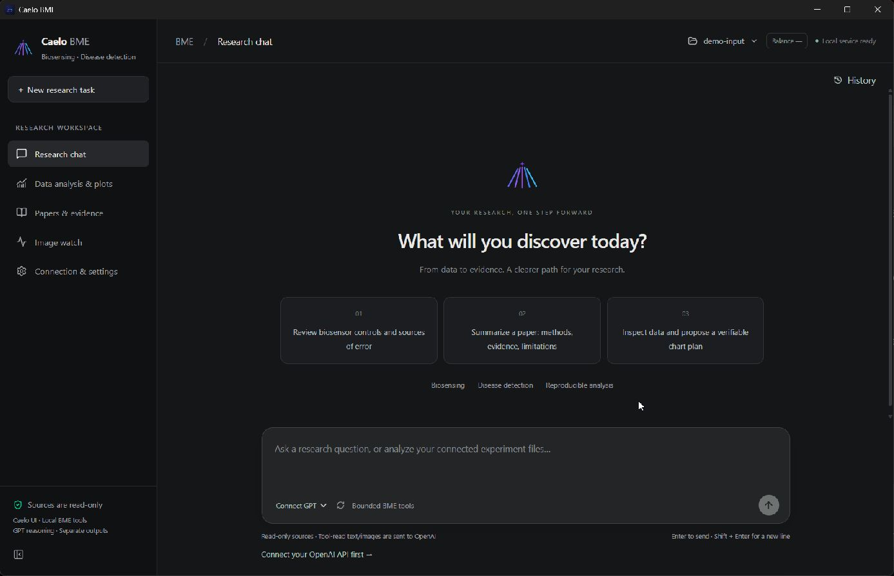

# BME Research Agent · English Desktop

A local-first biomedical research workspace for **biosensing experiments and disease-detection research**. The new **Caelo BME** edition combines an English desktop interface, optional GPT assistance, and fixed local tools for paper review, experimental reasoning, scientific plotting, and image-folder monitoring.

**Caelo BME v0.1.1 · Development preview · March–November 2026**

[English demo video](https://github.com/lengyuely2/bme-research-agent/releases/download/caelo-bme-v0.1.1/bme-agent-english-demo.mp4) · [Source & setup](caelo-bme/README.md) · [English transcript](caelo-bme/docs/demo/TRANSCRIPT.md) · [Subtitles](caelo-bme/docs/demo/bme-agent-english-demo.vtt) · [中文介绍](#中文介绍)

[](https://github.com/lengyuely2/bme-research-agent/releases/download/caelo-bme-v0.1.1/bme-agent-english-demo.mp4)

## English demo — real CLICK SA experiment

[**Watch or download the 2:55 narrated MP4**](https://github.com/lengyuely2/bme-research-agent/releases/download/caelo-bme-v0.1.1/bme-agent-english-demo.mp4) · [Repository copy](caelo-bme/docs/demo/bme-agent-english-demo.mp4)

The walkthrough uses the owner's **previously supplied real experimental data**, not generated measurements: **32 physical wells × 100 cycles = 3,200 readings**, with eight supplied concentration levels (0 and 10¹–10⁷). Every prepared reading and all 32 final-five-cycle endpoints were reconciled against the unchanged original workbook.


The video includes the actual English app home, figures generated by the application's analysis engine, and English explanation cards with narration. It is an **edited analysis walkthrough, not a continuous UI recording**. No live GPT response is simulated.

All records are retained. No points are deleted to force a rising concentration response. Concentration units were not provided, and physical wells are not assumed to be independent biological replicates. Original Excel/CSV files and full record-level audit bundles remain private. Only reviewed derived figures and media are public. [Read the method and publication scope](caelo-bme/docs/demo/REAL-DATA-METHOD.md).

## Research workflows

| Workflow | Implemented behavior |
| --- | --- |
| Research chat | Streaming GPT assistance for experimental steps, troubleshooting hypotheses, paper explanations, and everyday questions. |
| Local analysis | CSV/TSV/XLSX and recognized Spark kinetics; explicit axis/group/well mapping; mean with SD/SEM; review before export. |
| Scientific figures | Individual observations, grouped endpoints, time courses, PNG/SVG, statistics, source hashes and decision audits. |
| Paper review | Local text/PDF reading, physical-page citations and previews, optional GPT-assisted summaries. |
| Image watch | Stable new-image detection in a selected folder; local metadata notifications, without automatic uploads or model calls. |
| Local state | Conversation recovery, OS-encrypted API key, account model lookup, timestamped **manual** balance snapshot. |

Balance is not a live billing query. Model listing does not establish every model's tool/vision compatibility. General software automation and arbitrary code execution are not implemented in this restricted BME edition.

## Technology and data flow

| Layer | Technology |
| --- | --- |
| Desktop | Electron 45.2.1, native dialogs, context isolation and safeStorage |
| English UI | React 19, TypeScript, Tailwind CSS, Caelo components and Markdown |
| Local backend | Python 3.12, FastAPI, authenticated loopback REST/WebSocket |
| GPT integration | OpenAI Responses streaming with `store:false` and fixed BME tools |
| Analysis | Matplotlib, openpyxl, mean/sample SD/SEM, explicit exclusions and audit exports |
| Papers/images | pypdf, pypdfium2, Pillow, local polling |
| State & tests | SQLite/JSON; pytest, Vitest, TypeScript, ESLint and build checks |

A source folder is connected read-only. Fixed local tools inspect data and generate reviewable results in a separate output directory. Optional GPT calls receive the conversation and content deliberately read into context; connecting a folder does not upload the whole folder. Locally generated plots do not require a model call.

Unique output names, exclusive creation, and path checks guard source files. Arbitrary shell, source writes/deletes, Git mutations, external MCP/hooks/LSP/subagents, generated HTML execution, and upstream auto-updates are disabled. Normal chat sends directly; model-generated saved outputs require approval. These are application-level safeguards, not an OS sandbox or an absolute safety guarantee. This preview is for research, not clinical diagnosis.

## Start here

```powershell
git clone https://github.com/lengyuely2/bme-research-agent.git
Set-Location bme-research-agent/caelo-bme
```

Follow the [Windows source setup and test commands](caelo-bme/README.md#run-from-source-on-windows). Bring your own API key for GPT features; local analysis works without a GPT request. No credentials or signed installer are included.

| Directory | Purpose |
| --- | --- |
| [`caelo-bme/`](caelo-bme/README.md) | Current English Caelo-based desktop, Python backend, tests and demo |
| [`caelo-bme/docs/demo/`](caelo-bme/docs/demo/) | English MP4, subtitles, transcript and real-data method |
| Root `bioagent/`, `desktop/`, `tests/` | Preserved legacy v0.5.1 implementation |
| [`docs/legacy-v0.5.1.md`](docs/legacy-v0.5.1.md) | Archived bilingual legacy documentation |

Focused local validation: **23 Python + 29 frontend checks passed**, both TypeScript projects, changed-file ESLint, production build, and full video decoding passed. Live account quota/model access and clinical validity are not established by these tests. Inherited dependency advisories remain. [Validation details](caelo-bme/BME-VALIDATION.md).

## Attribution and licensing

The interface is based on [AuraVixStudio/caelo](https://github.com/AuraVixStudio/caelo), with its Apache-2.0 license and notices preserved. This independent integration is **not the official Grok web interface or xAI's Grok model**. Donated BME and legacy portions have no explicit reuse license; Caelo's Apache license is not automatically extended to them. See [provenance and licensing](NOTICE.md).

## 中文介绍

本项目面向生物传感、疾病检测研究，现提供 **Caelo BME 英文桌面版**，支持科研对话、实验步骤与问题分析、论文阅读、Excel/Spark 数据分析、绘图、图片文件夹监控和日常问答。技术栈为 Electron、React、TypeScript、Python FastAPI、Matplotlib 和可选 OpenAI GPT 接口。

README 的英文讲解视频使用你此前提供的 **CLICK SA 真实实验数据**，不是合成测量值：32 个物理孔、每孔 100 次实际读数、8 个浓度。演示保留全部读数，不为预期上升趋势删点；浓度单位与生物学独立性未明确。视频包含真实软件首页、软件分析引擎生成的科学图表和英文说明，并非连续操作录屏。公开内容仅为衍生图表和经过检查的媒体，原 Excel、CSV、逐条审计包留在本地。

原资料只读、结果独立另存，任意命令和原文件修改/删除禁用；余额为手动快照。应用层保护不能保证绝对安全，本项目用于研究、不用于临床诊断。英文版源码在 [`caelo-bme/`](caelo-bme/README.md)，旧版保留在根目录。来源与分别适用的许可状态见 [NOTICE](NOTICE.md)。
