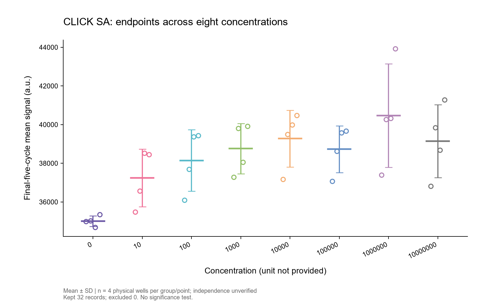
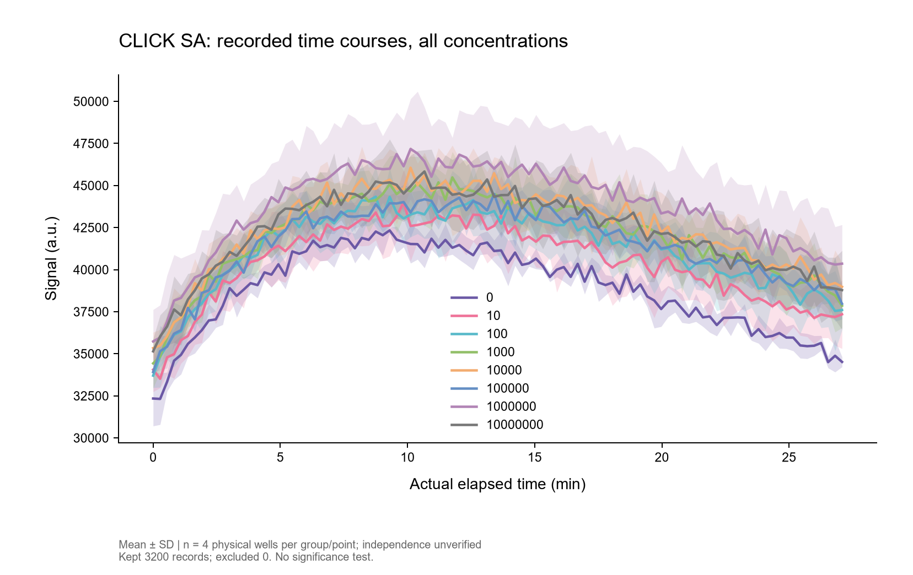
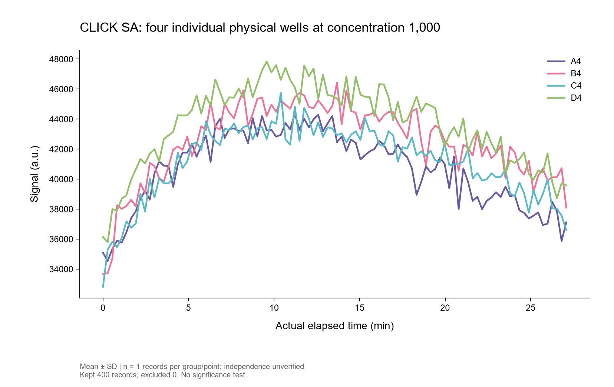

# BME Research Agent · English Desktop

A local-first biomedical research workspace for **biosensing experiments and disease-detection research**. The new **Caelo BME** edition combines an English desktop interface, optional GPT assistance, and fixed local tools for paper review, experimental reasoning, scientific plotting, and image-folder monitoring.

**Caelo BME v0.1.1 · Development preview · March–November 2026**

[Source & setup](caelo-bme/README.md) · [Real experimental results](#results-from-real-click-sa-data) · [Data and method](caelo-bme/docs/demo/REAL-DATA-METHOD.md) · [中文介绍](#中文介绍)

## Results from real CLICK SA data

These figures were generated by the software's local analysis engine from the owner's **previously supplied real experiment**, not generated measurements: **32 physical wells × 100 cycles = 3,200 readings**, with eight supplied concentration levels (0 and 10¹–10⁷). All readings and all 32 final-five-cycle endpoints were reconciled against the unchanged original workbook.

### Endpoint concentration response

Each open circle is one physical well's mean over its final five recorded cycles. Lines and error bars show mean and sample SD across four physical wells per concentration.



### Full recorded time courses

All 3,200 measurements are retained. Curves and shaded bands show mean and sample SD across four wells at each concentration and recorded cycle, using actual elapsed time.



### Four individual well traces

All 400 measurements from A4–D4 at the supplied concentration of 1,000 are shown separately. No uncertainty is invented for a single trace.



**Zero exclusions.** No smoothing, interpolation, or removal of points to force a rising concentration response. Concentration units were not provided; four physical wells are not assumed to be independent biological replicates. No live GPT call was needed for these local results.

Only derived result figures and the method note are published for this example. Original Excel/CSV files and record-level audit bundles remain private. [Read the method and publication scope](caelo-bme/docs/demo/REAL-DATA-METHOD.md).

## Research workflows

| Workflow | Implemented behavior |
| --- | --- |
| Research chat | Streaming GPT assistance for experimental steps, troubleshooting hypotheses, paper explanations, and everyday questions. |
| Local analysis | CSV/TSV/XLSX and recognized Spark kinetics; explicit axis/group/well mapping; mean with SD/SEM; review before export. |
| Scientific figures | Individual observations, grouped endpoints, time courses, PNG/SVG, statistics, source hashes and decision audits. |
| Paper review | Local text/PDF reading, physical-page citations and previews, optional GPT-assisted summaries. |
| Image watch | Stable new-image detection in a selected folder; local metadata notifications, without automatic uploads or model calls. |
| Local state | Conversation recovery, OS-encrypted API key, account model lookup, timestamped **manual** balance snapshot. |

Balance is not a live billing query. Model listing does not establish every model's tool/vision compatibility. General software automation and arbitrary code execution are not implemented in this restricted BME edition.

## Technology and data flow

| Layer | Technology |
| --- | --- |
| Desktop | Electron 45.2.1, native dialogs, context isolation and safeStorage |
| English UI | React 19, TypeScript, Tailwind CSS, Caelo components and Markdown |
| Local backend | Python 3.12, FastAPI, authenticated loopback REST/WebSocket |
| GPT integration | OpenAI Responses streaming with `store:false` and fixed BME tools |
| Analysis | Matplotlib, openpyxl, mean/sample SD/SEM, explicit exclusions and audit exports |
| Papers/images | pypdf, pypdfium2, Pillow, local polling |
| State & tests | SQLite/JSON; pytest, Vitest, TypeScript, ESLint and build checks |

A source folder is connected read-only. Fixed local tools inspect data and generate reviewable results in a separate output directory. Optional GPT calls receive the conversation and content deliberately read into context; connecting a folder does not upload the whole folder. Locally generated plots do not require a model call.

Unique output names, exclusive creation, and path checks guard source files. Arbitrary shell, source writes/deletes, Git mutations, external MCP/hooks/LSP/subagents, generated HTML execution, and upstream auto-updates are disabled. Normal chat sends directly; model-generated saved outputs require approval. These are application-level safeguards, not an OS sandbox or an absolute safety guarantee. This preview is for research, not clinical diagnosis.

## Start here

```powershell
git clone https://github.com/lengyuely2/bme-research-agent.git
Set-Location bme-research-agent/caelo-bme
```

Follow the [Windows source setup and test commands](caelo-bme/README.md#run-from-source-on-windows). Bring your own API key for GPT features; local analysis works without a GPT request. No credentials or signed installer are included.

| Directory | Purpose |
| --- | --- |
| [`caelo-bme/`](caelo-bme/README.md) | Current English Caelo-based desktop, Python backend, tests and demo |
| [`caelo-bme/docs/demo/`](caelo-bme/docs/demo/) | Real-data analysis method and publication scope |
| Root `bioagent/`, `desktop/`, `tests/` | Preserved legacy v0.5.1 implementation |
| [`docs/legacy-v0.5.1.md`](docs/legacy-v0.5.1.md) | Archived bilingual legacy documentation |

Focused local validation: **23 Python + 29 frontend checks passed**, both TypeScript projects, changed-file ESLint, and production build passed. Live account quota/model access and clinical validity are not established by these tests. Inherited dependency advisories remain. [Validation details](caelo-bme/BME-VALIDATION.md).

## Attribution and licensing

The interface is based on [AuraVixStudio/caelo](https://github.com/AuraVixStudio/caelo), with its Apache-2.0 license and notices preserved. This independent integration is **not the official Grok web interface or xAI's Grok model**. Donated BME and legacy portions have no explicit reuse license; Caelo's Apache license is not automatically extended to them. See [provenance and licensing](NOTICE.md).

## 中文介绍

本项目面向生物传感、疾病检测研究，现提供 **Caelo BME 英文桌面版**，支持科研对话、实验步骤与问题分析、论文阅读、Excel/Spark 数据分析、绘图、图片文件夹监控和日常问答。技术栈为 Electron、React、TypeScript、Python FastAPI、Matplotlib 和可选 OpenAI GPT 接口。

README 展示软件分析引擎使用此前提供的 **CLICK SA 真实实验数据**生成的三张结果图：终点浓度响应图、完整时间曲线和四孔独立曲线。数据为 32 个物理孔、每孔 100 次实际读数、8 个浓度。保留全部读数，不为预期上升趋势删点；浓度单位与生物学独立性未明确。此示例仅公开衍生结果图和分析说明，原 Excel、CSV、逐条审计包留在本地。

原资料只读、结果独立另存，任意命令和原文件修改/删除禁用；余额为手动快照。应用层保护不能保证绝对安全，本项目用于研究、不用于临床诊断。英文版源码在 [`caelo-bme/`](caelo-bme/README.md)，旧版保留在根目录。来源与分别适用的许可状态见 [NOTICE](NOTICE.md)。
